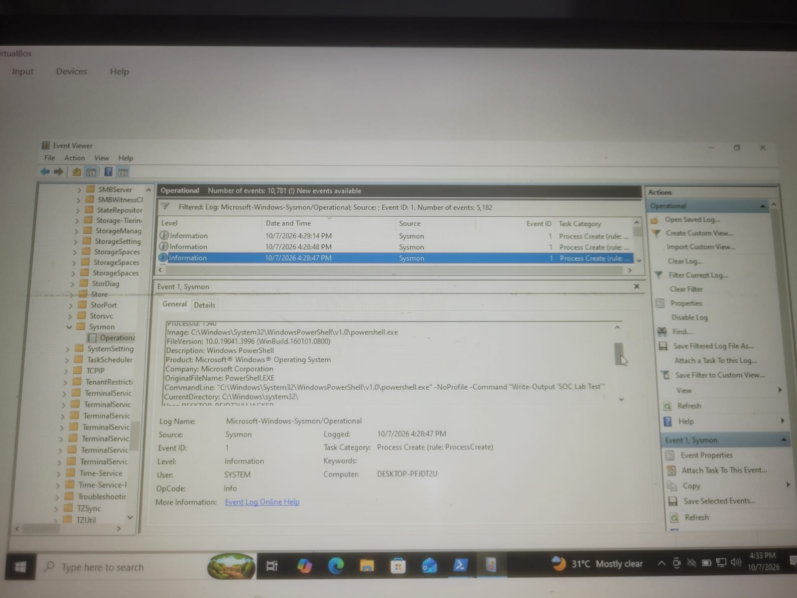
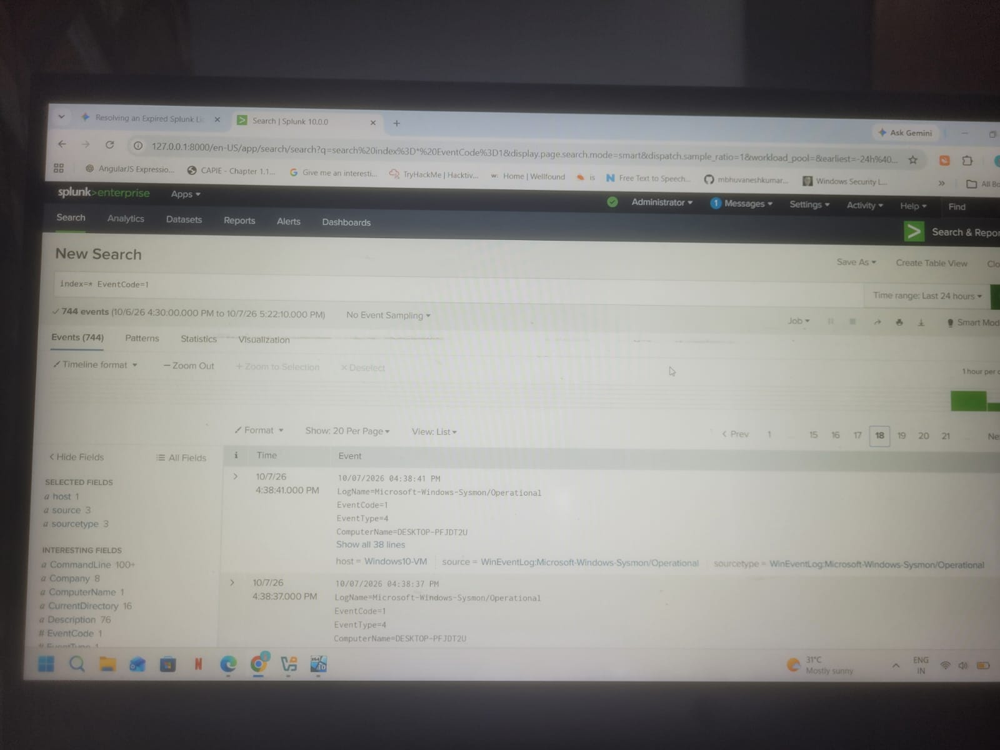

# Suspicious PowerShell Execution Detection with Splunk

## Overview

This project demonstrates the monitoring and investigation of PowerShell process execution using Sysmon, Windows event telemetry, and Splunk Enterprise in a controlled Windows 10 lab environment.

A harmless PowerShell command was executed to generate process-creation telemetry. Sysmon Event ID 1 was used to identify process creation activity, and the collected events were searched in Splunk.

A custom Splunk Search Processing Language (SPL) query was developed to identify PowerShell process execution and display relevant fields for investigation. The objective was to understand how a SOC analyst can monitor endpoint activity, investigate process execution, and assess whether an event is expected or suspicious.

**SOC Workflow:**

PowerShell Execution → Sysmon Telemetry → Splunk Ingestion → Detection → Investigation → Severity Assessment → Response Recommendation

---

## Objectives

- Generate harmless PowerShell process activity in a controlled Windows 10 lab.
- Understand Sysmon Event ID 1 (Process Create).
- Verify that process-creation events are available in Splunk.
- Develop an SPL query to identify PowerShell execution.
- Review process details and command-line information.
- Investigate the activity from a SOC analyst's perspective.
- Map the relevant behavior to MITRE ATT&CK.
- Document findings and recommended response actions.

---

## Lab Environment

| Component | Details |
|---|---|
| Operating System | Windows 10 |
| SIEM | Splunk Enterprise |
| Endpoint Telemetry | Sysmon |
| Log Collection | Splunk Universal Forwarder |
| Event ID | 1 - Process Create |
| Activity | Harmless PowerShell command |
| Environment | Controlled local lab |

---

## PowerShell Activity Simulation

A harmless PowerShell command was executed to generate process activity:

```powershell
Write-Output "SOC Lab PowerShell Test"
```

A separate PowerShell process was also launched using:

```powershell
powershell.exe -NoProfile -Command "Write-Output 'SOC Lab PowerShell Test'"
```

These commands were used only to generate test telemetry. No malware, destructive commands, or unauthorized systems were involved.

---

## Sysmon Event Analysis

Sysmon Event ID 1 records process-creation activity.

The event was reviewed in Event Viewer under:

**Applications and Services Logs → Microsoft → Windows → Sysmon → Operational**

The investigation focused on the following fields, where available:

- `Image` — executable path
- `CommandLine` — command used to launch the process
- `ParentImage` — parent process executable
- `User` — account associated with the process
- `ProcessId` — process identifier
- `ParentProcessId` — parent process identifier

The PowerShell event was used to verify that the test activity generated process-creation telemetry.

---

## Splunk Log Analysis

The initial search used to locate Sysmon process-creation events was:

```spl
index=* EventCode=1
```

To narrow the results to events containing PowerShell-related text, the following search was used:

```spl
index=* EventCode=1 powershell.exe
```

The actual field names depend on the event data and Splunk configuration.

Relevant fields to review include:

- `_time`
- `ComputerName`
- `User`
- `Image`
- `CommandLine`
- `ParentImage`
- `EventCode`

---

## SPL Detection Query

The following query identifies PowerShell process-creation events and displays useful investigation fields:

```spl
index=* EventCode=1
| search Image="*powershell.exe*" OR CommandLine="*powershell.exe*"
| table _time, ComputerName, User, Image, CommandLine, ParentImage
```

**Note:** This query assumes the events contain the `Image`, `CommandLine`, `ComputerName`, `User`, and `ParentImage` fields. If your Splunk data uses different field names, adjust the query to match the actual event fields.

### Query Explanation

1. Searches for Sysmon Event ID 1.
2. Filters for events containing PowerShell in the executable path or command line.
3. Displays the event timestamp and relevant process details.
4. Supports investigation of who launched PowerShell, what command was executed, and which process launched it.

This query identifies PowerShell execution; it does not independently prove malicious activity.

---

## Investigation

The PowerShell event was reviewed using the available process information.

The investigation considered:

- Which user launched PowerShell.
- Which executable was used.
- What command line was recorded.
- Which process launched PowerShell.
- Whether the execution was expected.
- Whether additional evidence suggested suspicious activity.

In this lab, the PowerShell command was intentionally executed for testing. The activity was therefore classified as authorized lab activity, not a confirmed security incident.

---

## Detection Limitations

PowerShell is a legitimate Windows administration tool and is commonly used for routine system management.

A PowerShell process-creation event alone is not sufficient to classify activity as malicious. More advanced detection may consider suspicious command-line arguments, encoded commands, unusual parent processes, network connections, user context, and related endpoint events.

Those indicators should be investigated only when supported by the available telemetry.

---

## Splunk Alert

If the SPL search is saved as a Splunk alert, document the actual settings used in your environment.

| Setting | Value |
|---|---|
| Alert Name | PowerShell Process Execution Detection |
| Alert Type | Scheduled, if configured |
| Severity | Medium, if configured |
| Detection | PowerShell process-creation activity |

An alert should be marked as successfully triggered only after it appears in Splunk's triggered-alert results. PowerShell execution by itself does not establish that an attack occurred.

---

## MITRE ATT&CK Mapping

**T1059.001 — PowerShell**

This technique describes the use of PowerShell for command and script execution. It is relevant to this monitoring scenario because PowerShell process activity was observed.

The mapping identifies relevant behavior; it does not mean the harmless test command was malicious.

---

## Recommended SOC Response

If a similar detection appeared in a production environment, a SOC analyst should:

1. Validate the alert and confirm the event details.
2. Identify the affected endpoint and user.
3. Review the executable path and command line.
4. Examine the parent process and surrounding process activity.
5. Determine whether the execution was expected and authorized.
6. Review related endpoint and network events when available.
7. Look for additional indicators of compromise.
8. Assign severity based on evidence and business context.
9. Escalate according to the organization's incident-response procedures if suspicious activity is substantiated.

---

## False Positives

Possible benign explanations include:

- Routine system administration.
- Authorized troubleshooting scripts.
- Software installation or maintenance.
- IT automation.
- User-launched PowerShell sessions.

The command line, user, parent process, endpoint context, and related events should be reviewed before classifying activity as malicious.

---

## Screenshots

### 1. Sysmon PowerShell Process Event



### 2. PowerShell Event in Splunk



### 3. SPL Detection Results


### 4. Splunk Triggered Alert


---

## Key Findings

- Harmless PowerShell activity was generated in a controlled Windows 10 environment.
- Sysmon Event ID 1 was used to examine process-creation activity.
- Splunk was used to search for PowerShell-related events.
- An SPL query was prepared to display process and command-line details.
- The activity was investigated using available endpoint telemetry.
- The test activity was identified as intentional lab activity rather than a confirmed incident.
- The behavior was mapped to MITRE ATT&CK T1059.001 — PowerShell.

---

## Conclusion

This project demonstrates a basic endpoint-monitoring use case using Sysmon and Splunk. It covers generating safe test activity, locating process-creation events, writing an SPL search, reviewing process details, and investigating the event from a SOC analyst's perspective.

The exercise provides practical experience with Windows process telemetry, Sysmon Event ID 1, SPL searches, endpoint investigation, false-positive assessment, and MITRE ATT&CK mapping.
