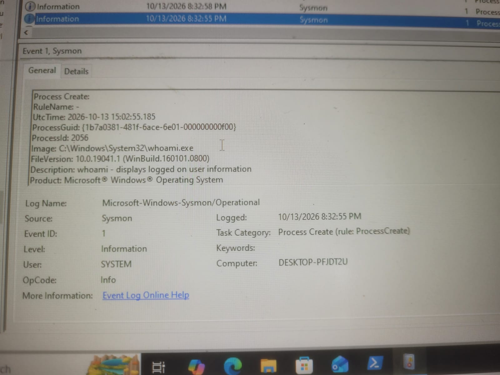
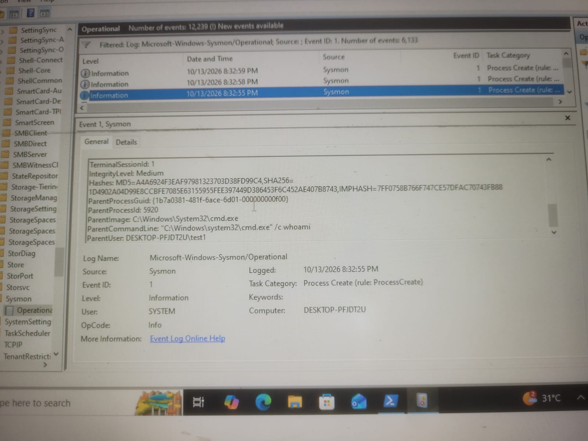
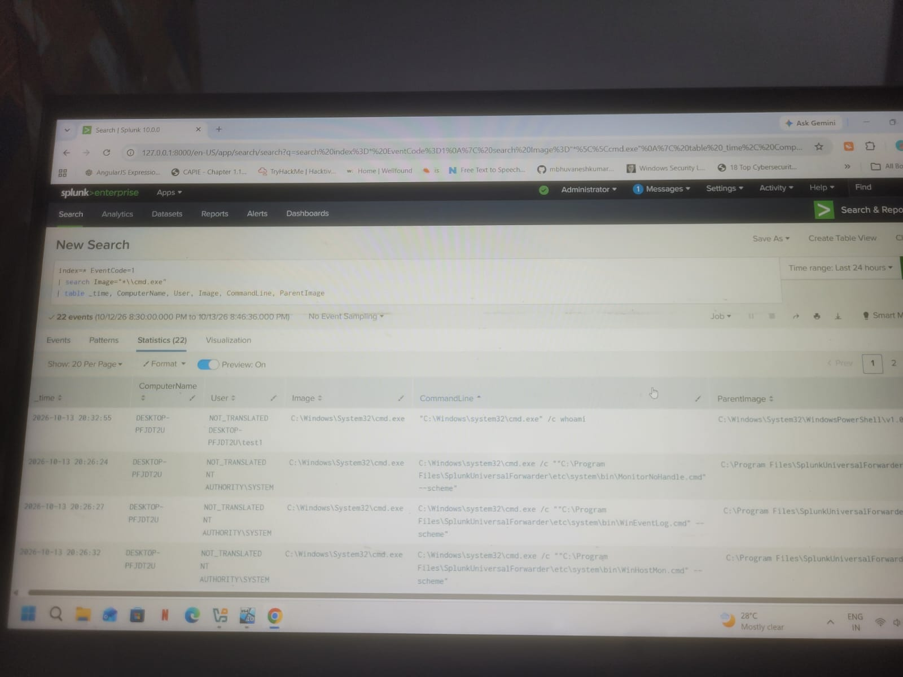
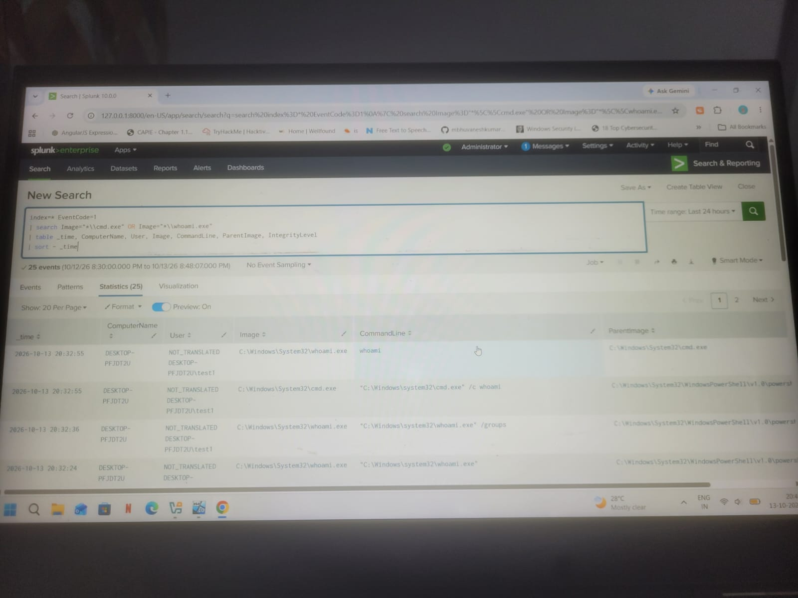
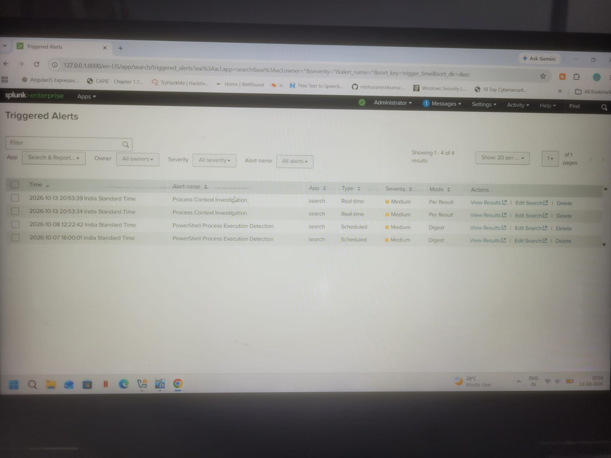

# Scenario 4: Windows Process Context Monitoring and Investigation with Splunk

## 1. Overview

This project demonstrates how to monitor Windows process creation events using Sysmon and Splunk. The objective was to identify selected process executions, investigate process relationships, review user and integrity context, and configure a Splunk alert to detect matching activity.

The lab was performed in a controlled Windows environment using benign commands such as `cmd.exe` and `whoami.exe`.

**Note:** This scenario demonstrates process monitoring and investigation. The observed activity does not, by itself, confirm privilege escalation.

## 2. Objectives

- Monitor Windows process creation using Sysmon Event ID 1.
- Investigate process names, command lines, parent processes, and user context.
- Search and analyze process events in Splunk.
- Configure a real-time Splunk alert for matching process activity.
- Validate that the alert triggers when matching events are detected.
- Understand the difference between suspicious activity and confirmed privilege escalation.

## 3. Lab Environment

- **Operating System:** Windows 10
- **Log Source:** Sysmon Operational log
- **Event ID:** 1 — Process Create
- **SIEM:** Splunk Enterprise 10.0.0
- **Activity:** Benign Windows process execution
- **Test commands:** `cmd.exe` and `whoami.exe`

## 4. Process Activity Simulation

The following commands were executed in the local Windows lab to generate process creation events:

```powershell
whoami
whoami /groups
cmd.exe /c whoami
```

These commands display the current user and group information and create process events for investigation.

## 5. Sysmon Event Analysis

Sysmon Event ID 1 records process creation activity. The generated events were examined in:

**Event Viewer → Applications and Services Logs → Microsoft → Windows → Sysmon → Operational**

The event details included:

- Process image: `C:\Windows\System32\whoami.exe`
- Process ID: `2056`
- Parent image: `C:\Windows\System32\cmd.exe`
- Parent command line: `C:\Windows\system32\cmd.exe /c whoami`
- Parent user: `DESKTOP-PFJDT2U\test1`
- Integrity level: `Medium`

These details help establish which process was executed, how it was launched, and the user context associated with the process.

The displayed event also showed `SYSTEM` in the general event summary. This should not be interpreted as proof that `whoami.exe` ran with SYSTEM privileges. The process-specific fields, including the user and integrity level, must be reviewed when determining execution context.

### Screenshot 1: Sysmon Process Creation



### Screenshot 2: Sysmon Process Details



## 6. Splunk Log Analysis

The Sysmon events were searched in Splunk using Event ID 1.

### Initial Search

```spl
index=* EventCode=1
```

### Process Investigation Search

```spl
index=* EventCode=1
| search Image="*\\cmd.exe" OR Image="*\\whoami.exe"
| table _time, ComputerName, User, Image, CommandLine, ParentImage, IntegrityLevel
| sort - _time
```

This search filters process creation events for `cmd.exe` and `whoami.exe` and displays relevant investigation fields.

The results included the process image, command line, parent process, timestamp, and available user and integrity information.

**Field note:** Field extraction can vary depending on the Sysmon input configuration and Splunk field mappings. The search should be adjusted if a field is not available in the environment.

### Screenshot 3: Splunk Process Events



### Screenshot 4: Process Investigation Results



## 7. Detection Logic

The detection logic identifies process creation events involving `cmd.exe` or `whoami.exe`.

```spl
index=* EventCode=1
| search Image="*\\cmd.exe" OR Image="*\\whoami.exe"
| table _time, ComputerName, User, Image, CommandLine, ParentImage, IntegrityLevel
```

This is a basic process-monitoring detection, not a standalone privilege-escalation detector. These utilities are commonly used for legitimate administrative and troubleshooting activities.

In a production SOC, an analyst should correlate process activity with integrity level, account privileges, parent-child process relationships, logon events, and other suspicious behavior before concluding that privilege escalation occurred.

## 8. Splunk Real-Time Alert Configuration

A Splunk alert named **Process Context Investigation** was configured to detect matching process activity.

**Alert details:**

- **Alert name:** Process Context Investigation
- **Search criteria:** Sysmon Event ID 1 for `cmd.exe` or `whoami.exe`
- **Alert type:** Real-time
- **Trigger mode:** Per result
- **Severity:** Medium

The alert was tested by executing a matching process in the lab. Splunk's Triggered Alerts page displayed entries for **Process Context Investigation**, confirming that the alert triggered for matching events.

### Screenshot 5: Splunk Alert Triggered



## 9. Investigation Findings

The investigation demonstrated that:

1. Sysmon recorded process creation events for the test commands.
2. Event ID 1 provided process and parent-process information.
3. Splunk ingested and displayed matching process events.
4. The SPL search identified the selected process activity.
5. The real-time Splunk alert triggered for matching events.
6. Process creation alone did not establish that privilege escalation had occurred.

## 10. MITRE ATT&CK Context

This lab demonstrates process monitoring that may support investigations into suspicious command execution.

**Important:** No specific privilege-escalation technique is claimed as observed in this exercise. Mapping should be based on evidence of a technique, not merely on the execution of `cmd.exe` or `whoami.exe`.

## 11. Recommended SOC Response

When investigating unusual process activity, a SOC analyst should:

1. Review the process image and command line.
2. Identify the parent process and process execution chain.
3. Verify the associated user account and integrity level.
4. Correlate the event with logon activity and other relevant endpoint events.
5. Determine whether the activity matches expected administrative behavior.
6. Escalate for further investigation if additional evidence indicates malicious activity.

## 12. False Positives and Limitations

- `cmd.exe` and `whoami.exe` are legitimate Windows utilities.
- Administrative scripts and troubleshooting may generate similar events.
- A process-name match does not establish malicious intent.
- A matching alert confirms that the configured detection condition was met, not that an attack occurred.
- Detection accuracy depends on Sysmon collection, field extraction, search scope, and alert configuration.

## 13. Conclusion

This lab demonstrated a basic endpoint monitoring workflow using Sysmon and Splunk. Windows process creation events were generated and analyzed, an SPL search was developed to identify selected processes, and a real-time alert was configured and validated.

The exercise strengthened practical skills in Windows event analysis, SPL searches, process-context investigation, alert validation, and evidence-based SOC triage.

## 14. Skills Demonstrated

- Windows Event Viewer
- Sysmon Event ID 1 analysis
- Splunk Enterprise
- Search Processing Language (SPL)
- Process and parent-process investigation
- Real-time alert configuration and validation
- SOC triage and false-positive awareness
- MITRE ATT&CK-informed investigation
